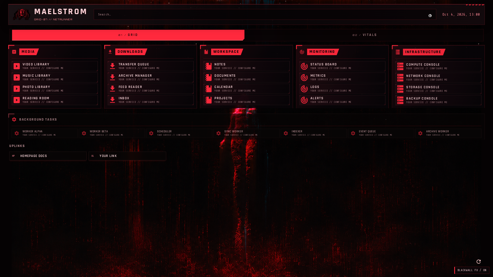
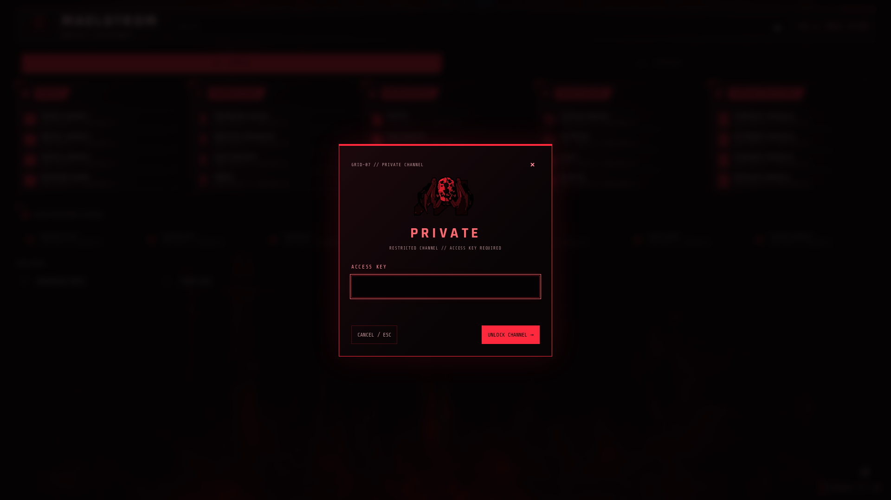
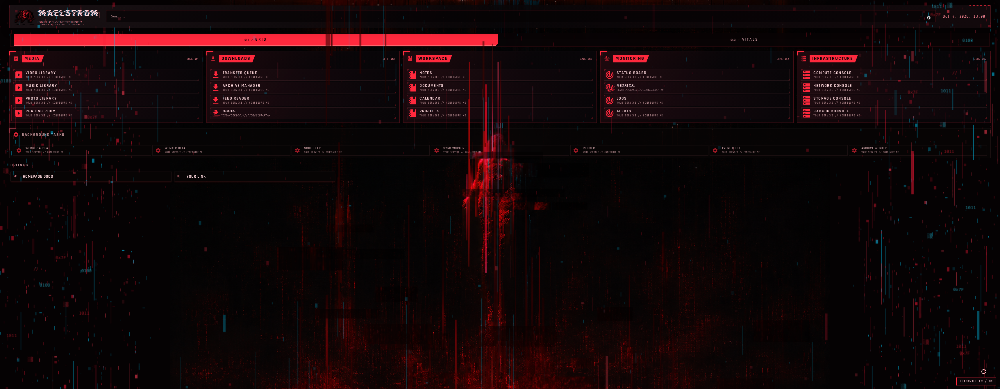

<div align="center">

# MAELSTROM // HOMEPAGE

**A red-and-black cyberdeck for [Homepage](https://gethomepage.dev/).**

Samurai boot sequence · crimson HUD · terminal-blue interference · compact service grid

[Get started](#get-started) · [Customize](docs/CUSTOMIZATION.md) · [Private tab](docs/SECURITY.md) · [Troubleshooting](docs/TROUBLESHOOTING.md)



</div>

A Cyberpunk 2077–inspired theme built around native Homepage services and widgets. Bring your own services: everything shown here is a fictional placeholder pointing to `example.com`.

## Features

- **Samurai boot animation:** ASCII decode, terminal sequence, click or Escape/Space/Enter to skip, once per tab session. An early loading curtain prevents the dashboard flashing before the intro.
- **Compact launcher:** five columns on wide displays, responsive layouts down to mobile, plus a compact background-task strip.
- **Three sections:** GRID for launchers, VITALS for your own health widgets, and an optional PRIVATE tab with a masked password dialog.
- **Blackwall interference:** eased pixel trails, displaced fragments and cyan channel echoes. Short 1.4–2.2-second bursts occur at irregular 30–150-second intervals, including the first burst.
- **Motion controls:** an FX switch, reduced-motion support, background-tab suspension, and suppression while typing or using dialogs.
- **Native interaction:** keyboard navigation, quicklaunch search, real widget updates and status highlighting. No invented operational statistics.
- **Readable HUD:** Rajdhani lettering, small Orbitron technical labels, crimson heading plates, clipped corners, Maelstrom emblem and the supplied red/black wallpaper.

The PRIVATE tab is a **client-side convenience lock, not authentication**. Its configuration remains accessible to someone who can access the dashboard. [Read the security notes](docs/SECURITY.md) before adding anything sensitive.

## Get started

Requires Docker with Compose and Python 3.10 or newer. Homepage is pinned to **v2.4.0**, the version tested with this theme.

```sh
git clone https://github.com/kusanag/maelstrom-homepage.git
cd maelstrom-homepage
python3 scripts/setup.py
# Optional: choose your own PRIVATE-tab access key, entered without echo.
python3 scripts/set-password.py
python3 scripts/start.py
```

The start helper runs Docker Compose, waits for readiness, and refreshes Homepage’s initially cached settings so the tabs appear on first use.

Open **http://localhost:3000**. By default the container listens only on your computer's loopback interface. No service credentials, infrastructure addresses, discovery integrations, or working default access key are supplied.

Setup creates `config/` and `.env`, both ignored by Git. Edit those local files for your deployment; the public examples remain generic. Re-running setup preserves existing configuration, theme edits and `.env`.

If port 3000 is already used, change `HOMEPAGE_PORT` and both port values in `HOMEPAGE_ALLOWED_HOSTS` in `.env`, then run `docker compose up -d` again.

## Add your services

Edit `config/services.yaml`, replace or delete the demo cards, and keep matching group names in `config/settings.yaml`:

```yaml
- WORKSPACE:
    - My Service:
        icon: mdi-application-#ff293d
        href: https://example.com/my-service
        description: A short description
```

Use Homepage's refresh control after YAML changes. Service widgets are optional: add their configuration using the [official widget documentation](https://gethomepage.dev/widgets/services/), with secret values supplied through your ignored `.env` file. [Full customization guide](docs/CUSTOMIZATION.md).

## Controls

| Action | Control |
| --- | --- |
| Skip the boot animation | Click, Escape, Space or Enter |
| Open PRIVATE unlock / re-lock an open tab | Ctrl + Shift + L |
| Cancel unlock and clear the field | Escape or Cancel |
| Toggle interference for this tab session | Bottom-right BLACKWALL FX button |
| Disable decorative motion | Operating system/browser reduced-motion preference |
| Replay the intro | Open a fresh tab, or clear `ms_boot_samurai_v2` from session storage |

The private key must be configured locally first. The password dialog needs HTTPS or `localhost` for browser cryptography. If a browser/desktop shortcut intercepts Ctrl+Shift+L, reassign it there or change the theme's shortcut. Changing the key requires closing existing dashboard tabs to clear their previous unlocked session.

## Preview

The screenshots use only the included fictional services.

| GRID | PRIVATE unlock |
| --- | --- |
|  |  |



## Project layout

```text
theme/             Shared CSS, JavaScript and artwork
examples/config/   Generic YAML starter configuration
scripts/           Local setup, password and publication checks
tests/             Setup and browser regression tests
docs/              Customization, security, troubleshooting and demo previews
config/            Your generated deployment — ignored by Git
.env               Your local environment — ignored by Git
```

## Update the theme

```sh
git pull --ff-only
# Back up any edits to config/custom.css, config/custom.js and supplied images first.
python3 scripts/setup.py --update-theme
docker compose restart homepage
```

The explicit update replaces local theme files and supplied artwork while preserving the local key, service YAML and `.env`. Refresh your browser afterward. Do not put backups inside tracked directories.

## Development and checks

```sh
python3 -m unittest discover -s tests -p 'test_*.py'
node --check theme/custom.js
python3 scripts/check-public.py
npm ci
npx playwright install chromium
# Start the local demo with the quickstart first.
npm run test:browser
```

Browser tests use `HOMEPAGE_URL` (default `http://localhost:3000`) and save screenshots in ignored `test-results/`. They use a browser-only test verifier for successful unlock tests; no key is written into the public template. See [CONTRIBUTING.md](CONTRIBUTING.md).

## Credits and license

An independent, noncommercial fan theme; not an official CD PROJEKT RED product. [Homepage](https://github.com/gethomepage/homepage) is a separate project. Code is MIT licensed; game artwork and other third-party materials are excluded from that license. See [LICENSE](LICENSE) and [THIRD_PARTY_NOTICES.md](THIRD_PARTY_NOTICES.md) for the artwork and fonts.
